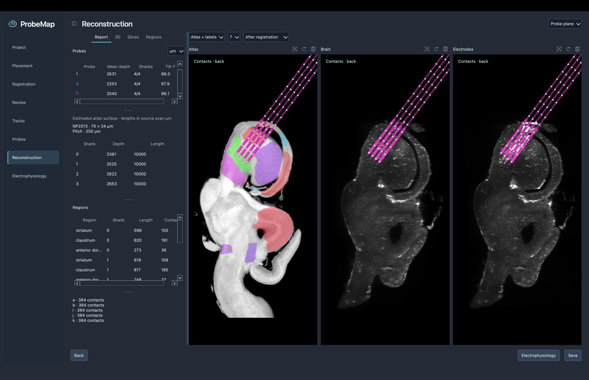

# ProbeMap

Align 3D brain scans with an atlas, reconstruct probe insertions, and compare anatomy with electrophysiology.



## What you can do

- Align TIFF volumes with paired landmarks.
- Trace insertions and place physical probe models in 3D.
- View recording sites and brain regions along each probe.
- Compare LFP, spikes, and anatomy on a shared depth axis.
- Create custom probes and export figures, volumes, transforms, and tables.

## Install and run

1. Install **Python 3.12**: [macOS](https://www.python.org/downloads/macos/),
   [Windows](https://www.python.org/downloads/windows/), or your Linux package manager.
   On Windows, choose 64-bit Python and include the Python launcher.
2. Download this repository (**Code → Download ZIP**) and unzip it.
3. Follow the steps for your system below. Internet access is needed during installation.

### macOS and Linux

Open a terminal in the unzipped folder containing `pyproject.toml`, then run:

```sh
python3.12 -m venv .venv
.venv/bin/python -m pip install --upgrade pip
.venv/bin/python -m pip install .
```

To open ProbeMap, run this command from the same folder:

```sh
.venv/bin/python -m probemap
```

On Mac, you can also use `scripts/start_probemap_macos.command` after installation.

### Windows

Open **`scripts`** inside the unzipped source folder:

1. Double-click **`install_probemap_windows.cmd`** and wait for installation to finish.
2. Double-click **`start_probemap_windows.cmd`** each time you want to open ProbeMap.

Keep `scripts` inside the source folder. The installer creates `.venv` beside `pyproject.toml`.
No terminal commands are needed.

All required Python dependencies are installed automatically. ANTs is optional;
see [full setup](docs/install.md) for ANTs, PowerShell commands, updates, and troubleshooting.

Tested locally on macOS. Full Windows/Linux desktop checks are still pending.
3D views need OpenGL.

## Start here

1. **New project**: choose an atlas, a brain scan, and a project folder.
2. **Placement → Registration → Review**: align the scan and check the result.
3. **Tracks → Probes → Reconstruction**: trace and inspect your insertions.
4. **Electrophysiology**: connect recordings and compare signal with anatomy.

Bring your own data; atlases and recordings are not included.
Raw recording import currently supports four-shank Neuropixels 2.0.

## Documentation

| Guide | Covers |
| --- | --- |
| [Setup](docs/install.md) | Installation, optional tools, updates, and troubleshooting |
| [Quick guide](docs/guide.md) | The full workflow, with screenshots |
| [Probe designer](docs/probes_library.md) | Templates, custom bodies, contacts, and geometry import/export |
| [Electrophysiology](docs/ephys_workspace.md) | Recordings, plots, time windows, units, and analysis settings |
| [Figure export](docs/figure-export.md) | PNG, SVG, and PDF figures |

<details>
<summary>Development notes</summary>

- [Repository layout and release checks](docs/development/releasing.md)
- [Ephys methods and notebook comparison](docs/development/ephys_notebook_comparison.md)
- [Ephys performance and verification](docs/development/ephys_performance.md)

</details>

## License

[MIT](LICENSE) · Copyright (c) 2026 Elena Egorova.
