# Quick guide

The screenshots show a Pogona project (PV140). Use your own atlas and scans.
Follow the sidebar from top to bottom; stop after Review if you only need alignment.

## 1. Project

Click **New project** and choose a project folder. Add:

| Input | Format |
| --- | --- |
| Atlas and brain scan | 3D grayscale TIFF stacks |
| Electrodes scan (optional) | A TIFF stack in the same physical frame as the brain scan |
| Labels (optional) | A folder of atlas-aligned binary TIFF masks, one per region |

Check the **X, Y, Z voxel sizes in µm**, especially when TIFF metadata is missing.
Label masks must share one grid; names such as `001_cortex.tif` supply region IDs and names.
No atlas download or scan preprocessing is included.

Click **Continue to placement**. For saved work, use **Open project** and select `project.json`.

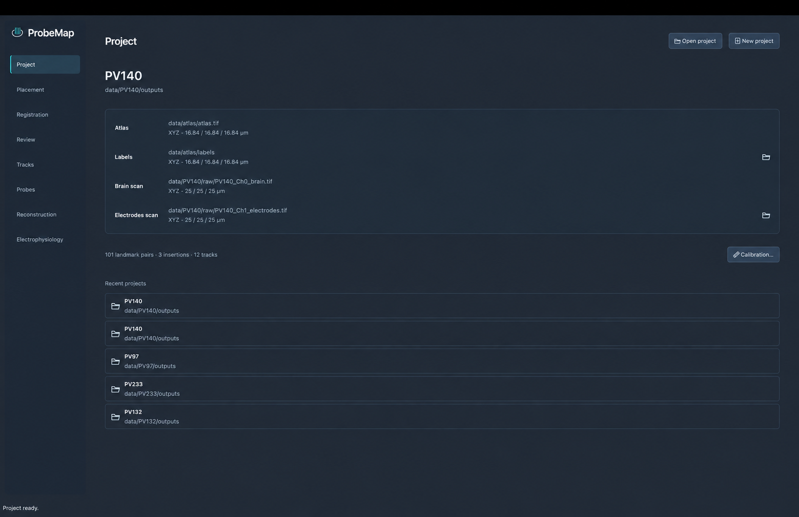

## 2. Placement

Use **Position**, **Rotation**, and **Scale** to bring the scan close to the atlas.
Change axis order or flips if needed. Check all three slice views, then click **Apply**.
Use **Visualization** for contrast/opacity and **Rendering** for the 3D view.

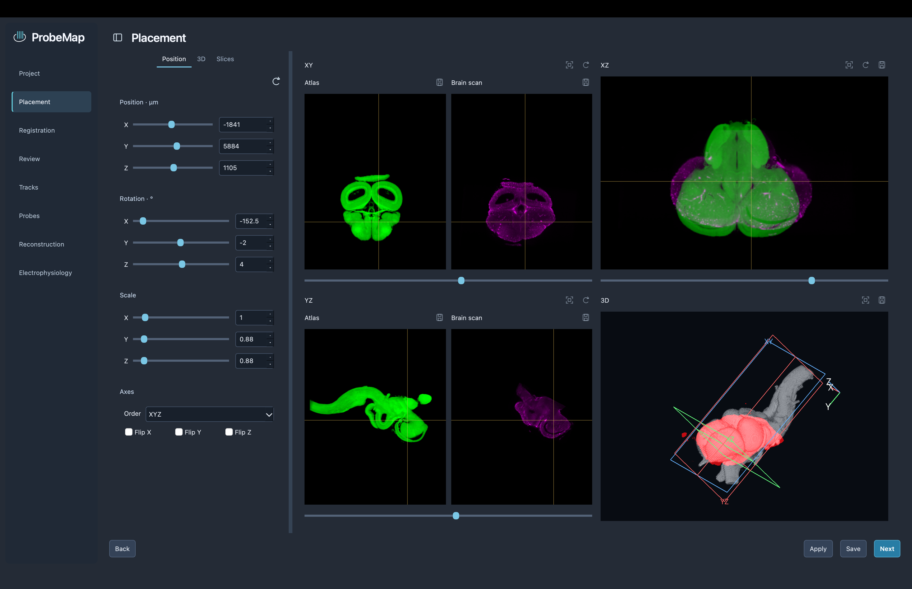

## 3. Registration

Use the add-point tool to mark the same landmark in the atlas and brain scan.
Spread pairs across the brain and several slices. Choose **Affine** (at least four
non-coplanar pairs), **Similarity**, or **Rigid** (at least three non-collinear pairs).
Click **Apply** to fit the transformation.

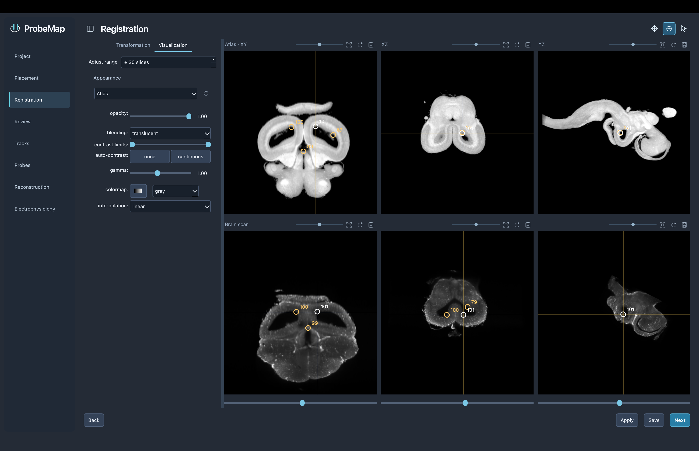

## 4. Review

Check the overlay and 3D view. In **Slice comparison**, compare **Atlas**, **Before**,
and **After** through several slices. Return to Registration to correct poor matches.
Reapply registration after changing landmarks or placement.

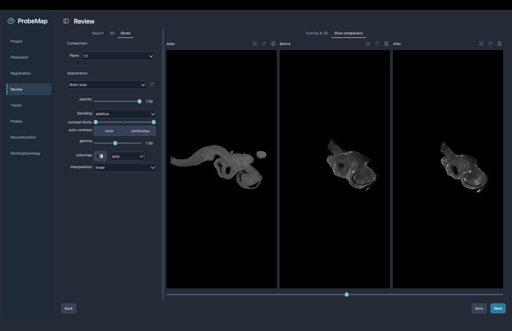

## 5. Tracks

Add an electrodes scan on Project if you have not already.
Click **+** in Insertions, select **Add points**, and mark visible tracks in the slices.
Use **Select points** to edit them. **Measure distance** adds a ruler between two points.
Keep each physical insertion in its own row.
Click **Apply** or **Next** to compute its plane. This needs at least three
non-collinear points; for a single straight track, adjust the plane manually on Probes.

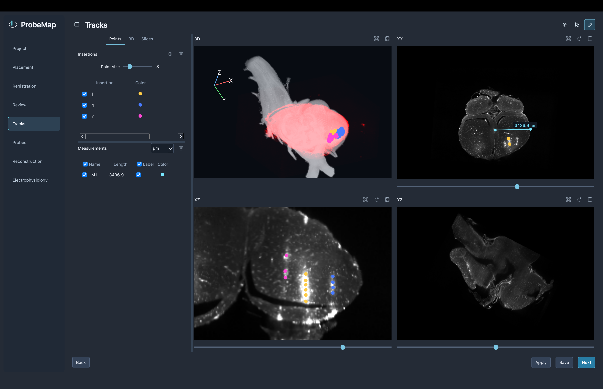

## 6. Probes

Select an insertion and a probe **Model**. Check the plane against the electrode scan;
expand **Plane** to adjust it. With **Place probe**, click at the deep tips and drag
toward the base. Use **Select / move probe** or numerical fields to refine placement.
Check recording face and shank order. Add recording metadata and link it to an insertion
to show which contacts were recorded. Click **Apply** or **Next** to save placement.

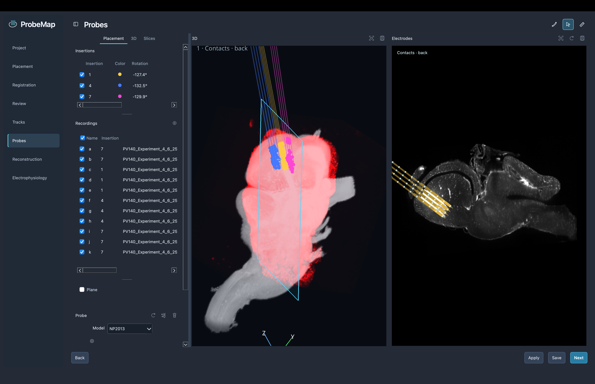

## 7. Reconstruction

Switch between **3D**, **Slices**, **Comparison**, and **Probe plane**.
Inspect anatomy, recording sites, surface entries, and region labels.
Use **Atlas** or **Source scan** space to check placement before and after registration.
Region assignments depend on both the alignment and the supplied masks.

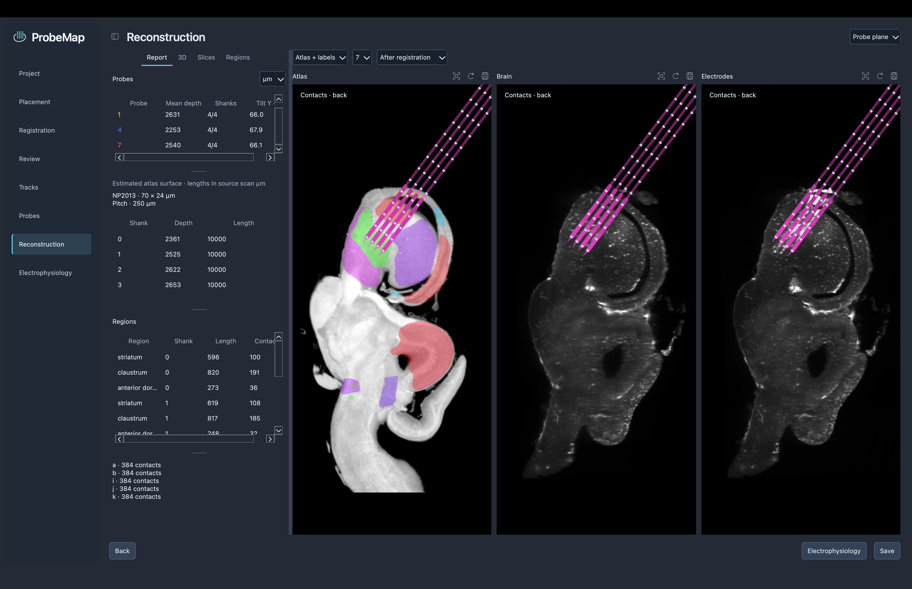

## 8. Electrophysiology

1. In **Recordings**, click **+** and select recording folders containing matching
   SpikeGLX `.ap.meta` / `.ap.bin` files. Link each recording to an insertion.
2. Click the recording's **Prepare signal** icon once. Right-click a row to
   **Connect Kilosort…** if sorting was not found automatically.
3. In **Plots**, choose **Add plot…**. Drag the plot list to change order;
   double-click a plot to edit its settings.
4. Use the bottom timeline and **Window** for a selected interval. Prepared LFP
   uses the local cache; original-recording analysis needs the raw file.
5. Use **Anatomy** for labels, **Marks** for depth levels/boundaries, and **Units**
   for raster visibility and independent waveform selection. Save the panel as PDF.

Available views include LFP power/spectrum, spectral depth gradient, correlation,
traces/clusters, relative CSD, AP RMS, spikes, waveforms, ISI, autocorrelation,
firing rates, amplitudes, region summaries, and recording comparisons.
Depth is measured from the physical probe tip. Fitted transitions are estimates,
not automatic anatomical labels.

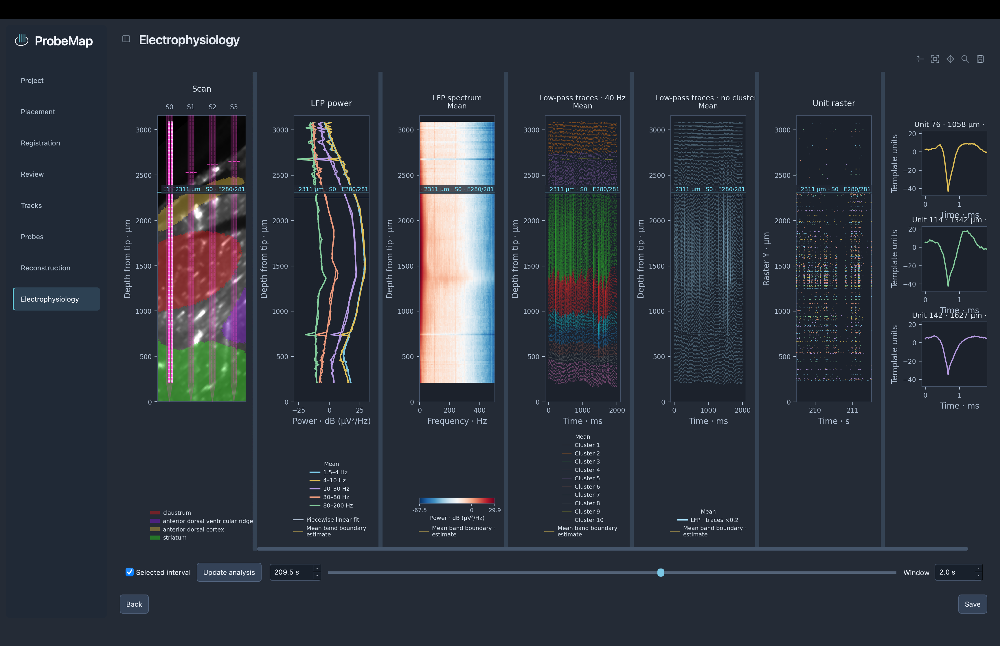

## Custom probes

Open **Probes Library → Probes Library…**. Choose a template, **Duplicate**, or
**Create probe…**. Edit the body, add contacts, and save. Select that model on Probes.
JSON preserves the full geometry; CSV transfers contact centres only.
Custom geometry does not add support for a new raw recording format.

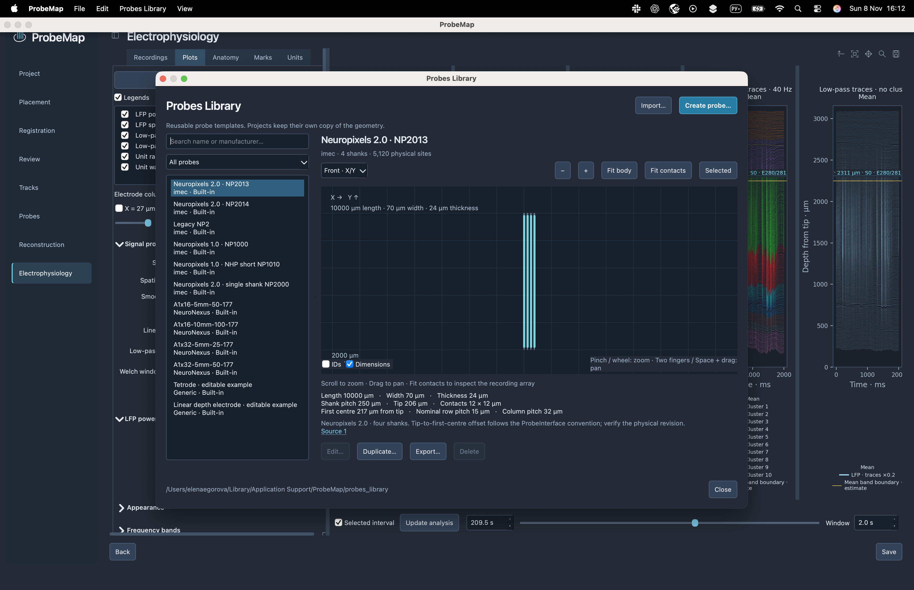

[Probe designer details](probes_library.md)

## Save and export

Use **File → Save project** (Ctrl/Cmd+S); saved projects reopen with their settings.
Use **File → Export…** for TIFF/OME-TIFF volumes, transforms, registration errors,
analysis tables, and reconstruction reports. The save icon above a view exports
a figure: PNG/SVG for image and 3D views, PDF for electrophysiology.

[Figure export](figure-export.md) · [Ephys settings](ephys_workspace.md)

More screenshots

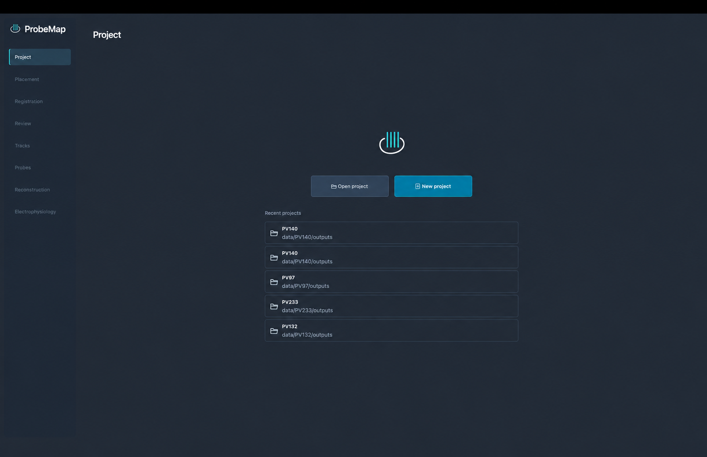
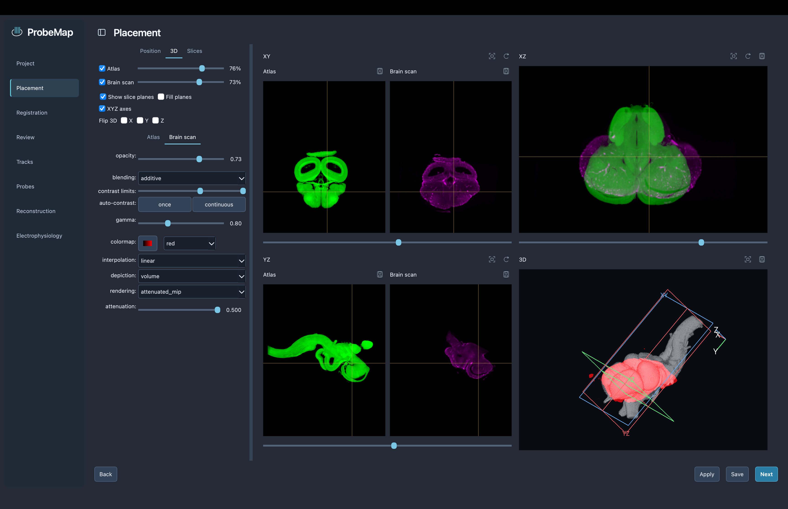
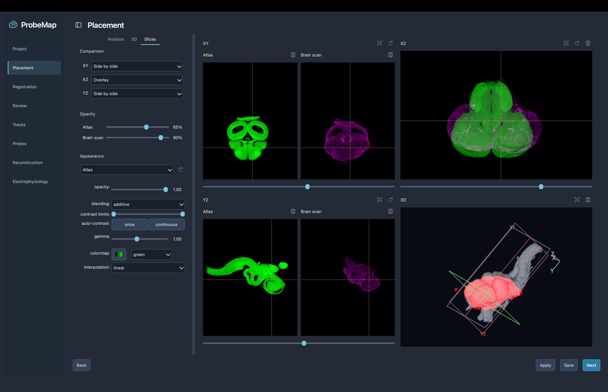
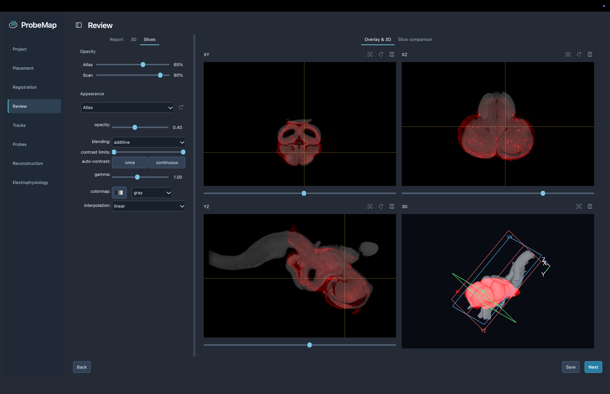
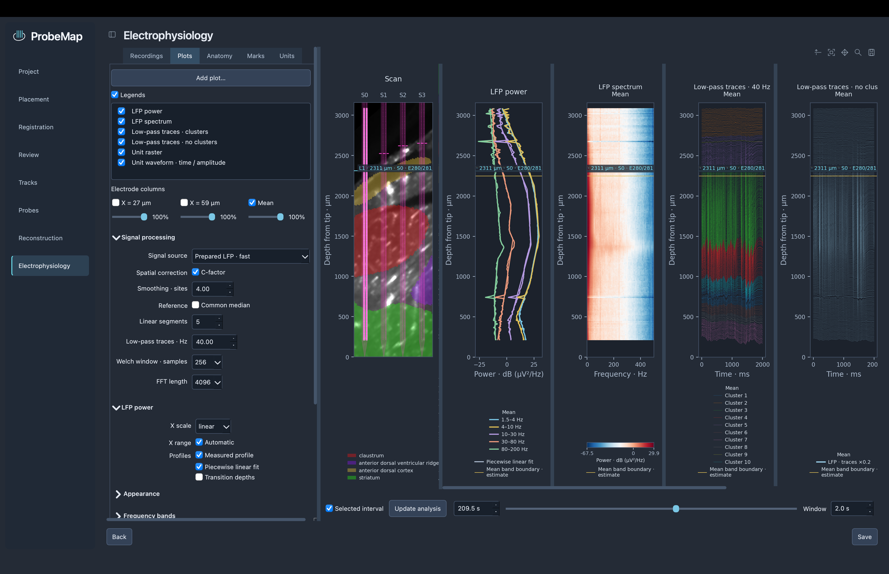
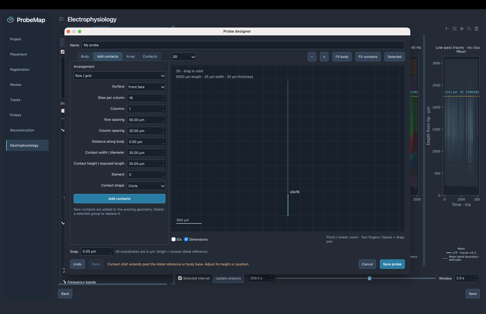

